# Home Widgets

Apple-style widgets for your Mac desktop. They're lightweight, you can customize them, and they update live.

Home Widgets is a native Mac app (Swift + SwiftUI, no Electron) that pins widgets to your desktop, behind your windows like the widgets in macOS Sonoma and later. Unlike Apple's widgets, these update every second, launch apps, show your CPU/GPU, Claude Code sessions, GitHub, CI runs and Slate notes, and come in shapes Apple doesn't offer.

<p align="center"></p>

## Install

You need macOS 14 Sonoma or newer, plus Apple's free developer tools. Open **Terminal** and paste these lines one at a time:

```bash
xcode-select --install
```

If a window pops up, click **Install** and wait for it to finish. If it says the tools are already installed, that's fine. Then:

```bash
git clone -b claude/sweet-bell-9o7yth https://github.com/ProffesorDiggamore/MacOS-Home.git
cd MacOS-Home
make install
```

**Home Widgets** lands in your Applications folder and opens. It has a Dock icon like a normal app: click it any time to bring back the window.

### Update to the latest version

```bash
cd ~/MacOS-Home && git pull && make install
```

### Start fresh (delete and re-download)

```bash
cd ~ && rm -rf ~/MacOS-Home && git clone -b claude/sweet-bell-9o7yth https://github.com/ProffesorDiggamore/MacOS-Home.git && cd MacOS-Home && make install
```

Your widgets and settings are kept either way. They live in `~/Library/Application Support/HomeWidgets`.

| Command | What it does |
| --- | --- |
| `make install` | Build, copy to Applications, and open |
| `make update` | `git pull` + `make install` |
| `make run` | Build into `./build` and open without installing |
| `make uninstall` | Remove the app from Applications |

## Widgets (93)

| Category | Widgets |
| --- | --- |
| **Time & Date** | Clock · Analog Clock · World Clock · Calendar · Countdown · Year Progress · Flip Clock · Word Clock · Binary Clock · Stopwatch · Sun · Big Date · Time Rings · **Dot Clock** |
| **School & Planning** | Month · Up Next (with Join for Zoom/Meet/Teams) · This Week · Class Schedule · Homework · Bible Reading Plan |
| **System** | System Stats · CPU · GPU · Memory · Storage · Network · Battery · Top Processes · About This Mac · Disk Activity · Wi-Fi · Volume · Clipboard History · Sound Output · Microphone · Keep Awake · IP Address · Internet · **Dev Servers** · **Device Batteries** |
| **Tools** | Timer · Web Search · Dictionary · Unit Converter · QR Code · Password Generator · Color Picker · Recent Files · Screenshots · **Dev Toolkit** |
| **Productivity** | Claude Code · App Shortcuts · Quick Actions (+ your Shortcuts) · Reminders · Focus Timer · Sticky Note · Folder · Weather · To-Do List · Habits · Quick Links · Calculator · Counter · Water · **Git Status** |
| **Accounts & Web** | GitHub · Contributions · GitHub Actions · Slate Notes · Slate Today · Slate Streak · Mail · News Feed (any RSS) · Hacker News · Stocks · Crypto · Currency · Sports Scores · Website Monitor · Service Status · Air Quality · GitHub Repo |
| **Photos, Text & Media** | Now Playing · Photo · Sticker · Text · Verse of the Day (KJV) · Moon Phase · Quote of the Day · **On This Day** |
| **Fun & Aesthetic** | Claude Crab · Game of Life · Breathe (floats on the wallpaper, no box) |

**New in version 4** in bold:
- **Dot Clock**: the time in glowing LED dots; square sizes stack the hours over the minutes. Pick the dot colour, 12/24-hour and seconds.
- **Dev Servers**: everything you've started that's listening on a localhost port (Vite, Node, Python, Postgres…). Click one to open it.
- **Git Status**: a repo's branch, ahead/behind, staged/changed/new counts and last commit; the large size lists the changed files. Click to open the repo in Terminal, Finder or VS Code.
- **Dev Toolkit**: live Unix time, ISO 8601 and a UUID, all click-to-copy; the large size adds clipboard buttons (Base64, decode, URL-encode, pretty JSON, lower/UPPER).
- **On This Day**: a moment from history on today's date, from Wikipedia. Click for another; right-click to read the article.
- **Device Batteries**: battery rings for your Mac and connected AirPods (with the case), mice, keyboards and controllers.

### Wallpapers
**Settings › Wallpapers** has five kinds. Every style comes in seven tones — Silver, Obsidian, Pearl, Midnight, Prism, **Moss** (green and grey) and **Your Colors**, where you pick a background, ink and accent — which set the backdrop, chrome tint, paper and ink:
- **Studio**: ray traced on your Mac's graphics chip with real reflections, refraction and dispersion under soft studio lights: Liquid Chrome, Chrome Veins, Satin, Soft Layers, Glass Ribbon, Liquid Metal, Glass Sculpture and Glass Pills.
- **Sketch**: drawn stroke by stroke: **Power Lines** (pen poles, tangled wires, pylons and birds), **Plum Blossom** (a gnarled ink tree with hundreds of blossoms, a poem and seals), **Ink Lotus** (a crowded sumi-e pond with reeds) and **Misty Peaks** (layered mountains, pines, a waterfall and a boat).
- **Poster**: **Glass Type** (liquid glass drops bending oversized type behind them) and **Attractor** (millions of points from one chaotic equation, printed with its formula).
- **Glitch**: **Datamosh** (a mossy waterfall corrupted into blocks, smears and drips), **Pixel Sort** (marbled noise with its pixels sorted into streaks) and **Chrome Melt** (liquid chrome glitched and dripping).
- **Pixel**: **Pixel Night** (a 1-bit moonlit lake), **Dithered Chrome** (liquid chrome in MacPaint-style dots) and **ASCII** (liquid chrome drawn in characters).

Click the preview (or ⌘R) to shuffle; only the style you're on changes, so the others don't re-render. Then **Set as Wallpaper**. Size is *Best* (4K or the display's own pixels, whichever is sharper), 4K, 5K, 6K or 8K; each display gets its own copy, saved in *Pictures › Home Widgets Wallpapers*. **Save PNG…** exports one. A 4K render takes about half a second to two seconds on Apple silicon.

### Sizes

| Size | Shape | Good for |
| --- | --- | --- |
| Small | 1×1 | most widgets |
| Medium | 2×1 | lists, graphs |
| Large | 2×2 | dashboards |
| **Tall** | 1×2 | portrait photos, notes, to-dos |
| **Wide** | 4×1 | banners: app docks, stocks, news |
| **Extra Large** | 4×2 | big photos, dashboards |
| **Portrait** | 2×3 | tall photos, Slate's today page |

Right-click any widget › **Size** to change it.

### Your own images
- **Sticker**: any image floating on your desktop with no box around it. Drag an image onto it, or paste one. Pictures that already have a transparent background are used as they are; ordinary photos get their subject cut out automatically (the same Vision model as *Copy Subject* in Photos). Turn that off, or go back to the original, in Edit Widget.
- **Photo**: a single transparent PNG floats without a frame, like a sticker.
- **Photo**: drag photos onto it to build an album (click to go to the next one), or point it at a folder. Frames: Edge to Edge, Polaroid (with a caption), or Framed.
- **Any widget** can have a background photo, with sliders to darken and blur it so text stays readable: right-click › Edit Widget › Background Photo.

Images you add are copied into the app's own storage, so they keep working even if you delete the originals.

### Claude Code
- **Session list**: 🟠 working, 🟢 your turn, ⚪ ended. Click a live one to jump to its terminal, or an ended one to resume it.
- **Just the Crab** (Edit Widget › Show): the pixel crab from the Claude Code logo. It works when Claude is working, bounces when it's your turn, and naps when everything's idle.
- **Claude Crab** widget: a desktop pet that wanders around. Click it to make it jump.

### Accounts
Open **Settings › Accounts**:
- **GitHub**: click *Create a Token on GitHub* (it pre-selects the right permissions), paste it, and click *Connect*. This powers the GitHub, Contributions and GitHub Actions widgets.
- **Slate** (formerly Cairn): paste the token you already use in Slate (Contents read & write on your notes repo), or reuse the GitHub token. Set each Slate widget's repo to the same notes repo Slate syncs with (and the same *Folder in the repo*, if you use one). The widgets sit on Slate's stone grey with its logo:
  - **Slate Notes** shows notes that exist right now, newest first, with their emoji or made icons, plus today's daily note; quick capture adds bullets or to-dos to `Daily/YYYY-MM-DD.md`, which Slate picks up on its next sync.
  - **Slate Today** lists the to-dos in today's daily note with a progress ring. Click one to tick it off; the change is committed to the repo.
  - **Slate Streak** counts the days in a row you've written a daily note and maps the year.
  - Clicking a note opens it in Slate at slatenotes.netlify.app (change or clear the address in the widget's settings).
- **GitHub Actions** uses the GitHub token: it shows the latest workflow run for each repo you list, or for the repos you pushed to most recently.
- **Mail**: works with any account added to Apple's Mail app (Gmail, iCloud, Outlook). No token needed.

Tokens are stored in your Mac's Keychain. Because the app is signed locally, macOS may ask for your password once after each update so the new version can read them.

## Using it
- **Dock icon** opens the Home Widgets window: Widget Gallery, My Widgets, Accounts, Appearance, General.
- **Drag** a widget anywhere. Widgets live on a grid like the iPhone Home Screen, centred on the screen so a full desktop has even margins: while you drag, a dashed slot shows exactly where it will land, and it always lands in free space — widgets can't overlap. When the desktop is full, adding a widget tries its smaller sizes and otherwise tells you there's no room instead of stacking it on top of another.
- **See-through widgets** (Clear style, stickers, very low opacity) show a soft glowing outline when the pointer is over them, and while any widget is being dragged, so you can always find and grab them.
- **Right-click** a widget to resize it, restyle it, edit it, or remove it.
- **Appearance**: Frosted Glass, Liquid Glass (macOS 26), Solid, Tinted or Clear; light/dark; accent color; font; opacity.
- **Widget Colors** (Appearance): every colour a widget uses — the CPU ring, GPU ring, graphs, icons — belongs to one of five families (reds, oranges, greens, blues, purples). **Theme** lets you pick a colour for each family, or a preset (Green · Yellow · Blue is the default; Apple, Ocean, Sunset, Neon and more), and every widget changes at once. **One Color** paints everything in a single colour; **Original** keeps each widget's own colours. To give one widget different colours, right-click it › **Colors** (or **Edit Widget**) and choose *Its Own Theme* or *One Color*.
- **General**: widgets on the desktop or floating above windows, lock positions, open at login, Dock/menu bar icons, refresh rate, °F/°C.
- **Grid** (General): drag *Position* to slide every widget up or down together, for example to keep the bottom row clear of the Dock. *Rows* uses fewer rows than fit, which leaves more room to move.

## Permissions
macOS asks the first time a widget needs something. Calendar and Reminders ask for those; Weather and Sun ask for Location (or type a city instead); Now Playing, Mail, Dark Mode and Empty Trash ask for Automation; Folder asks for Files & Folders.

## How it stays lightweight
- Native AppKit windows + SwiftUI. No web views, no background daemons.
- About 3.5 MB installed: `make app` builds with link-time optimisation and size-optimised code, and the icon is stored as grey-only images.
- Each data source only runs while a widget that uses it is **visible** — covered by windows or on another Space counts as hidden, so a CPU graph behind your browser costs nothing.
- Animated widgets **pause automatically when covered by windows**, and resume instantly when you swipe back from a full-screen app.
- Volume, microphone and sound devices come from Core Audio change notifications (no polling); Now Playing updates the moment Music or Spotify changes track.
- CPU/GPU/memory/disk come straight from the kernel and IOKit, with no shell commands.

## Credits
Weather and air quality by [Open-Meteo](https://open-meteo.com) · Public IP via [ipify](https://www.ipify.org) · Stocks via Yahoo Finance · Currency via [Frankfurter](https://frankfurter.app) (ECB) · Sports via ESPN · Scripture from the King James Version (public domain).
